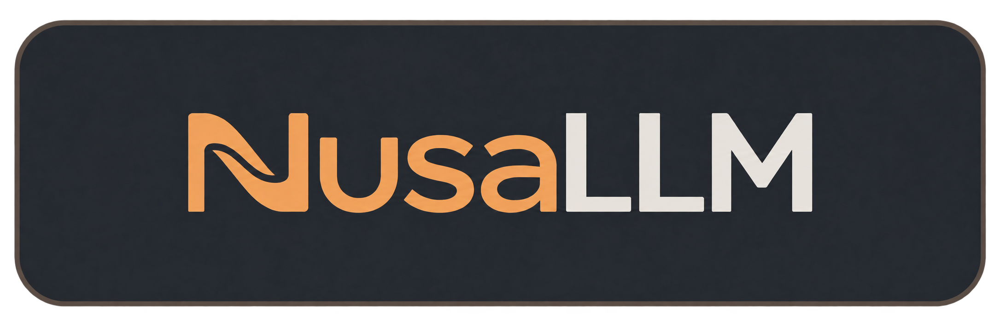

<div align="center">



Many islands, one sea.

[](https://github.com/jahrulnr/NusaLLM/actions/workflows/ci.yml)
[](LICENSE)
[](go.mod)
[](.github/pull_request_template.md)

</div>

The *Nusa* in NusaLLM comes from Nusantara for an archipelago:
many islands, each with a character of its own, joined by one sea.

NusaLLM is a conversation engine for many model providers, and the design follows that
picture. Each provider route is an island with its own wire style and models. The
conversation is the sea between them, carrying you from one island to the next without
losing the voyage. The terminal REPL and a loopback browser UI (`nusallm serve`) are two
ways into the same engine.

## Islands: your providers

A route is one island, called a gateway in the CLI: an id, an endpoint, a wire style, a
credential reference, a model catalog, and a streaming flag. `nusallm onboard` is a guided
wizard for the wire style, endpoint, models, and API key. The `nusallm gateway` subcommands
(`list`, `show`, `add`, `set`, `delete`) manage them.

Each route speaks one of four wire styles:

- `completion`: OpenAI-style chat completions. Covers OpenAI, OpenRouter, DeepSeek, Groq, xAI,
  Mistral, and other compatible endpoints.
- `responses`: the OpenAI Responses API.
- `messages`: the Anthropic Messages API.
- `generatecontent`: Gemini `generateContent`.

A model can pin its own wire style under its route.

Switching route or model mid-conversation changes the wire format, but the stored history is
not rewritten. In the REPL, `/route <id>` and `/model <id>` pick one. If only one healthy
route or model exists, it is selected automatically.

A route stores only a credential reference, either `env:VAR_NAME` (read at send time) or a
key vaulted in a local SQLite file (mode 0600). Keys are never written to conversation
records or gateway files.

## The sea: your conversations

Each message is written to disk as it happens, not only on exit, so conversations survive
restarts. Every conversation has its own folder under `<storage.dir>/conversations/`.
`/list` shows them, and `/resume <id>` picks one back up. `/title <text>` sets the title,
and `/export <file>` writes the conversation out as markdown.

`/edit <message-id> <text>` rewrites one of your own messages, drops everything after it,
and regenerates the turn.

`/compact` has the model write a checkpoint, then seals the older history into numbered
segments. The last 4 messages stay live (`compact_keep_tail`). Compaction also runs by
itself when the estimate reaches 90% of the model's input budget (`compact_budget_pct`),
and once when a provider answers with HTTP 413.

Lines typed during a turn queue and run in order. `/steer <text>` injects your text into
the running turn at the next safe point, after a tool result and before the next model
call. `/cancel` interrupts the turn, and Esc recalls a pending steer or queued line.

## Harbor: the workspace

Your harbor is the workspace: the directory where you launch `nusallm`. `read_file`,
`write_file`, and `apply_patch` are confined to it. `read_media` loads images, audio, or
video so the model can see or hear them. It also accepts absolute host paths, so it can read
files outside the workspace, and it pins the content by its sha256 hash.

Agent tool calls run automatically, with no approval step for each call. `exec` runs
one-shot shell commands in the launch environment with a 120 s default timeout, and it is
not sandboxed. A turn can keep calling tools for up to 512 steps by default (`max_turn_steps`).

## You want it? Let's make it.

Custom tools are plain executables on the `PATH` that the agent's `exec` uses.

- Put one in `.agents/tools/bin/` in the workspace, or in `~/.agents/tools/bin/`. `tools.paths` in config also works.
- There is no manifest, no registration, and no SDK.
- Add a companion `SKILL.md` in `.agents/skills/` to tell the agent when to use it.
- The built-in `tool-creator` skill scaffolds the executable, a Python implementation, and a companion skill. Python is not required for custom tools.

## Quick start

```sh
make build              # builds ./bin/nusallm (needs Go 1.26.5 or newer)
./bin/nusallm onboard   # guided setup: wire style, endpoint, models, hidden API key prompt
./bin/nusallm           # opens the REPL
```

Optional, CLI only: `./bin/nusallm serve install --no-service` copies the binary to
`~/.local/bin/nusallm`. Inside the REPL, `/route <id>` and `/model <id>` pick a route and
model. `onboard` needs an interactive terminal.

## Docs

- [Docs index](docs/README.md)
- [CLI guide](docs/cli-guide.md)
- [Architecture](docs/architecture.md)
- [Domain model](docs/domain-model.md)
- [Persistence](docs/persistence.md)
- [Adapters](docs/adapters.md)
- [Extending](docs/extending.md)
- [WebUI API contract](docs/api/contract.md)

## License

GNU GPL v3. See [LICENSE](LICENSE).
