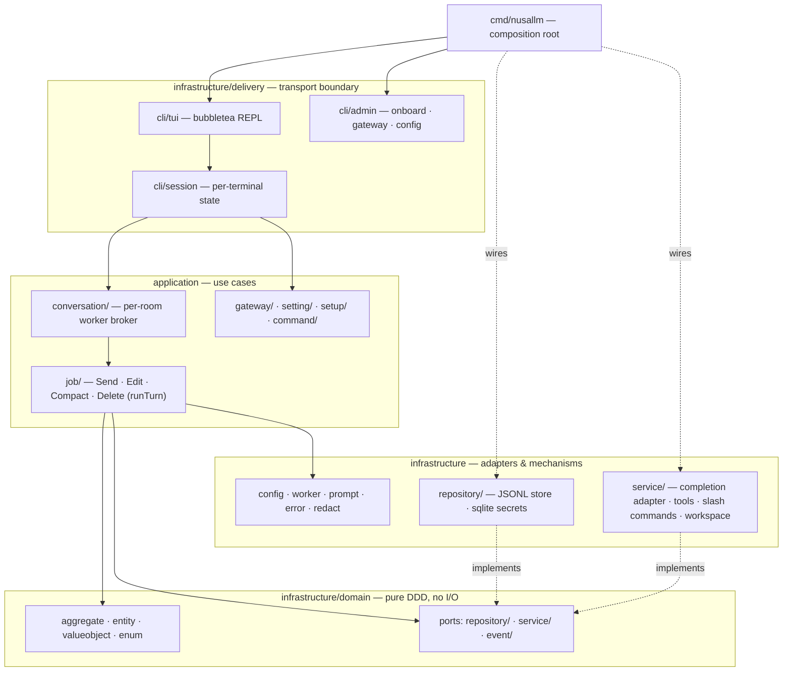

# Architecture

NusaLLM is a provider-agnostic LLM conversation engine with a terminal
client on top of it (module `github.com/jahrulnr/nusallm`, Go 1.26.5).
The bet the codebase makes — stated in the [README](../README.md) — is
that the engine owns conversations, tools, and history while interfaces
come and go. The terminal REPL is the first transport, not the product,
and the layering exists to keep that promise cheap: swap the delivery
boundary or add a provider wire and nothing about what a conversation
*is* changes.

This document describes the layers, the rules that keep them honest, and
the end-to-end path of one turn. Companion documents go deeper:
[the domain model](./domain-model.md) covers aggregates, entities, and
enums; [the persistence layer](./persistence.md) covers storage formats;
[adapters](./adapters.md) covers provider wires and tools;
[the CLI guide](./cli-guide.md) covers the REPL surface; and
[extending](./extending.md) walks through adding a provider or tool.

## Layer map



| Package | Role |
|---|---|
| `cmd/nusallm` | Composition root: argv mux, then wires repositories, adapters, tools, and apps in `main.go` |
| `infrastructure/delivery/cli` | Terminal boundary — `tui/` bubbletea model, `session/` per-terminal state, `commands/` registry wiring, `admin/` operator subcommands, `term/` ANSI safety |
| `infrastructure/delivery/http`, `infrastructure/delivery/websocket` | Placeholder packages only — the transport boundary the design reserves, not implemented |
| `application/conversation` | Broker: maps conversation ids to per-room `worker.Worker`s, owns queue order, preemption, eviction, shutdown |
| `application/job` | The use-case bodies: `Send`, `Edit`, `Compact`, `Delete`, `Rename`, and the shared `runTurn` agent loop |
| `application/gateway` | Gateway management: upserts, vault key-reference writes, sanitized `GatewayInfo` projections |
| `application/command` | `SlashSession` port + `Facade` — the surface slash-command handlers see |
| `application/setting`, `application/setup` | Operator view/mutation of the JSON config file; first-run config provisioning |
| `infrastructure/domain` | Pure domain: `aggregate/`, `entity/`, `enum/`, `valueobject/`, `event/`, plus ports in `repository/` and `service/` |
| `infrastructure/repository` | Port implementations: `conversation/` JSONL store, `gateway/` JSON records, `secret/` sqlite vault, `log/` JSONL diagnostics |
| `infrastructure/service` | Outbound adapters: `core/text/completion/` wire adapter, `tool/` implementations, `command/` slash-command handlers, `workspace/` sandbox, `wire/` shared encoding helpers |
| `infrastructure/config`, `worker`, `prompt`, `error`, `redact` | Mechanisms: settings parsing, the serial job executor, embedded prompts, the error contract, credential scrubbing |

## The dependency rule

Dependencies point inward. `infrastructure/domain` imports nothing
outside the standard library and itself: the ports for persistence
(`infrastructure/domain/repository`), provider calls and tools
(`infrastructure/domain/service`), and streaming (`infrastructure/domain/event`)
live inside the domain as interfaces, and every implementation lives
outside it. `TextModelService.Send` in `infrastructure/domain/service/text.go`
is the canonical example — the application holds a `map[enum.Style]dservice.TextModelService`,
never an `*http.Client`.

The application layer speaks almost only to those ports.
`application/job.Deps` (`application/job/job.go`) is the whole reach of a
use case: two repository ports, the service map, the tool map, and
normalized config. The single concrete inbound dependency is deliberate
and covered by the layer's own rules — `application/job/compact.go`
imports `infrastructure/service/tool/summary` because compaction's
scratch dialogue is itself the use case, and "explicit use-case
collaborators" are allowed where a port would be indirection for its own
sake. Everything else in `application/` is port-shaped: nothing there
knows what JSONL is or what SSE stands for.

Everything concrete meets in `cmd/nusallm/main.go`. The function `run`
loads config, opens the sqlite secret store, constructs the filesystem
repositories, builds the one `completion`-style service adapter,
constructs the five agent tools, and hands all of it to
`appconversation.New` and `tui.NewREPL`. The file's own comment sets the
tone: for admin subcommands "this file is the mux, not the handler" —
routing to `infrastructure/delivery/cli/admin` functions that return
exit codes, keeping even argv dispatch a delivery concern.

A consequence worth internalizing: `application/conversation` could host
a CLI, an HTTP handler, or a test harness with identical results, and the
http/websocket trees exist as placeholders precisely because the design
expects them. The mechanism is deliberately unfinished; the direction is
not.

## Who owns a rule

The repository's `AGENTS.md` files do something unusual: they assign every
*decision* an owner before assigning code a home. The root file states it
plainly — "the package's location does not make a new rule appropriate
there" — and the per-layer files refine it:

- **Domain** (`infrastructure/domain/AGENTS.md`) owns every invariant that
  should hold for any caller and any provider: whether a message may be
  edited (`Conversation.RewriteFrom`), whether a tool may be offered to the
  model (`ToolSchema.CallableByAgent`), how token accounting adds up
  (`Usage.Add`). It is "thin and pure" — business rules and normalized
  state, no I/O, no wire formats, no provider vocabulary in field names.
- **Application** (`application/AGENTS.md`) owns sequencing and policy:
  queue order and preemption live in `conversation/`; route selection,
  when to persist, when to compact, tool execution, and event emission
  live in `job/`; gateway lifecycle and sanitized projections live in
  `gateway/`. It *enforces* domain decisions but must never reimplement
  them — the file warns explicitly that "existing code is not proof of
  correct ownership", citing `gateway/buildModel`'s negative-parameter
  check as input validation that would belong on `entity.Model` if it
  ever became a model-wide rule.
- **Repositories** (`infrastructure/repository/AGENTS.md`) own storage
  mechanics — record shapes, hydration, atomic writes, segment surgery —
  and may re-guard storage constraints (an id about to become a path
  segment is revalidated), but never restate a business rule. The file is
  candid about the debt: `rewriteCut` currently duplicates the
  editability check in `Conversation.RewriteFrom`, and the instruction is
  to align them, or better, push the shared decision down into domain.
- **Services** (`infrastructure/service/AGENTS.md`) own protocol
  translation and side effects: one request/response leg on the wire,
  one tool execution, one slash command. Route selection, retries,
  conversation mutation, and tool *permission* are all explicitly owned
  elsewhere.
- **Mechanisms** (`infrastructure/AGENTS.md`) — `config`, `worker`,
  `prompt`, `error`, `redact` — implement contracts and nothing else.
  `prompt/` loading text must not silently redefine a domain invariant;
  `worker/` schedules interruptible jobs "without knowledge of
  conversations"; `config/` defaults are configuration, "not domain
  meaning".

The practical upshot for anyone editing the tree: when a change spans
layers, trace from use case through port to adapter, put each decision at
its owner, and update the callers. Do not mirror the check in the outer
layer because that is where the stack trace happened.

## Anatomy of a turn

Everything below is the real path, traced through the code. The cast:
`infrastructure/delivery/cli/tui/model.go` (the Elm-style update loop),
`infrastructure/delivery/cli/session/session.go` (terminal session
state), `application/conversation/send.go` (the broker entry),
`application/job/send.go` and `turn.go` (the use case),
`infrastructure/domain/service/text.go` (the port), and
`infrastructure/service/core/text/completion/` (the adapter).

### 1. Delivery: input becomes a submission

In `replModel.submit` (`tui/model.go`), an Enter keypress trims the line
and pushes it onto `m.queued`. A turn in progress defers the line
("queued — runs after this turn"); `/cancel` is the exception, dispatched
immediately because it is an interrupt, not work. `drain` pops the queue
and `dispatch` classifies it: `/edit` and `/compact` get dedicated turn
paths (`beginEdit`, `beginCompact`), other `/name` lines go to the slash
registry, and plain text becomes `beginTurn`.

`beginTurn` resolves routing *on the update loop* via
`Session.ResolveRoute` — explicit `/route` + `/model` picks, then the
conversation's stored binding, then an auto-selection when exactly one
ready gateway or model exists. The turn goroutine receives the resolved
pair as arguments so nothing races the status line's reads. It then
launches a `tea.Cmd` calling `Session.Send` with a `turnPump` handler
that funnels `TurnEvent`s back into the loop as `turnEventMsg`s.

`Session.Send` (`cli/session/session.go`) adds the transport-specific
guards: refuse a `Broken` gateway, confirm the model is in the gateway
catalog, and warn (via `Notify`, never fail) when a pending attachment's
modality exceeds `Model.AcceptsInput`. Then it calls
`ConversationApp.Send`.

### 2. Broker: the conversation is a room with one worker

`ConversationApp.Send` (`application/conversation/send.go`) mints a
`c_<base32>` id when the caller passes none — the returned `SendResult`
always names the room so streamed events can be attributed — then posts
an `appjob.Send` to the room's worker through `post`.

`post` (`application/conversation/conversation.go`) owns the worker map:
spawn on demand, `Submit` FIFO for sends, `Preempt` for edit/delete —
preemption interrupts the running job *and* cuts ahead of the wait line,
so an edit lands on the turn it just killed while queued sends still run
against rewritten history. A full mailbox answers 429; a submit racing
teardown gets `ErrClosed` and is reposted onto the successor worker —
"a job that arrives after the room died belongs to the next room, not the
corpse." Workers are reaped when idle, and `Delete` retires one
explicitly by returning `worker.ErrTerminate`, which drains the queue to
410 replies and frees the id.

The worker itself (`infrastructure/worker/worker.go`) is deliberately
dumb: one goroutine, a bounded queue, `Execute` on its own context,
`Interrupt` as the soft stop and `Terminate` as the hard one. It knows
nothing about conversations — which is exactly why conversation policy
stays testable in the application layer.

### 3. The job: load, bind, persist the user line

`Send.Execute` (`application/job/send.go`) runs on the worker's goroutine
under a ctx that dies on caller cancel, `Interrupt`, or worker kill —
`Base.Cancellable` composes all three, and `finish` guarantees a reply so
a wedged waiter never happens.

The body reads plainly because the rules are already placed:

1. `Convs.Load` the aggregate; a 404 means create it (an FE-minted id
   becomes the room's name, a job-level 400 covers an invalid one).
2. `resolveRoute` picks route and model — job overrides win, then the
   stored binding — and resolves them to live objects: the `Gateway`
   aggregate via `Gateways.Load` (key refs dereference here, and only
   here), the `Model` from `gw.Model(modelID)`, and the adapter from
   `Services[gw.Style()]`. No adapter registered for the style is a 500
   "deployment defect, not a user error."
3. Build the user `entity.Message`, attach uploads, `conv.Append`.
4. On a fresh room, bind route/model and derive the title from the first
   line *before* the first write — a failed send still leaves a room that
   can retry with empty overrides.
5. Apply the embedded system prompt when the aggregate lacks one. This is
   deliberate: the prompt "is code, not data," shipped in the binary via
   `infrastructure/prompt` (embedded `system/conversation.md`) and never
   persisted, so a template upgrade reaches every room on its next send.
6. `AppendMessage` the user line under the `PersistenceReceipt` — the
   receipt answers "did my message commit?" even when the caller's ctx
   won the race, which is what lets the UI distinguish "your message is
   in history but the turn died" from "nothing happened." A fresh room
   whose user line never committed is rolled back via `Delete`.

### 4. The agent loop: `runTurn`

`Deps.runTurn` (`application/job/turn.go`) is shared by Send and Edit —
the one extraction the layer's own method-shape rule sanctions, since it
is reused. Each iteration:

- **Maybe compact.** `maybeCompact` compares `conv.EstimatedTokens()`
  (a chars/4 heuristic plus a flat 1000 per attachment — a budgeting
  number, never billing truth) against `model.CompactionBudgetTokens(
  CompactBudgetPct)`. The budget is computed per call so a mid-session
  model switch applies immediately. At most one compaction per turn; a
  tail that still overflows after folding is "the provider's call."
- **Call the provider.** `svc.Send(ctx, conv, gw, wireModel, onEvent)` —
  one attempt. Before the loop, `conv.SetTools(d.ToolSchemas())` reapplies
  the live tool catalog every turn because a stored conversation can
  predate the catalog; without it "the model invents names it was never
  offered."
- **413 means believe the provider.** If the estimate said fine but the
  provider returned `StatusPayloadTooLarge` and no compaction ran yet,
  `runTurn` compacts once and retries — the one place the error
  contract's status drives a behavior today.
- **Verify the port contract.** The port promises one assistant append
  per call; `runTurn` diffs `conv.Messages()[before:]` rather than
  trusting `conv.Last()`, so a misbehaving adapter cannot silently
  duplicate or drop.
- **Persist immediately.** Each appended message goes through
  `AppendMessage`, then `Save` flushes meta (bindings, usage). A crash
  mid-loop leaves messages and accounting consistent — the paid-for
  reply survives even if the caller already walked away.
- **Execute pending calls.** `pendingCalls` selects `TooltypeOrigin`
  calls with no output on the last message. For each, `execTool` checks
  the schema's `CallableByAgent` — the permission decision lives on the
  `ToolSchema` value object and fails closed — then runs
  `tool.Execute(ctx, call, emit)`. Executor failures become the tool's
  output ("the model deserves honest results"); only cancellation aborts
  the turn. `msg.SetToolOutput` wraps the text in the untrusted-evidence
  envelope (delimiter strings inside the output are neutralized so the
  envelope can't be spoofed) and `UpdateToolCallOutput` persists a patch
  record keyed by call id — resolvable globally, so a call sealed into an
  archive segment before its output arrived still patches correctly.
- **Loop or stop.** No pending calls ends the turn. Hitting
  `MaxTurnStep` (default 512) returns a 500 and *keeps* the unanswered
  calls in history — "the model did ask," and a retry replays them.

Back in `Send.Execute`, a successful turn re-binds the resolved
route/model and `Save`s — an existing room adopts an override only when
the turn under it succeeded, so a failed retry leaves the old binding
intact.

### 5. The adapter: one wire leg

`textcompletion.Service.Send`
(`infrastructure/service/core/text/completion/completion.go`) is a
stateless translator — endpoint, key, and stream flag come off the `gw`
argument every call, so a re-`Load`ed gateway (rotated key, moved
endpoint) takes effect without touching the service.

`encodeRequest` maps domain state onto the OpenAI-shaped body: system
prompt to a system message, messages through `encodeMessage` (model-origin
calls become `tool_calls` plus `tool` role messages; injection calls are
folded into text — they must not pose as provider calls; output media ride
a synthetic user message after the tool block because the tool role is
text-only), only `CallableByAgent` schemas reach the wire, pointer-based
generation params omit themselves when unset, and `optionalContent` keys
namespaced `completion.*` land verbatim as extra request fields.
Attachments — `file://`, `https://`, `data:` — are materialized here by
`infrastructure/service/wire` helpers: local files reopen under the
workspace root, per-modality byte caps apply, and a recorded `sha256` pin
must still match the resolved bytes or the part degrades to a text
placeholder.

The POST goes to `{endpoint}/chat/completions` with the resolved key.
In stream mode (`gw.StreamMode()`), `streamResponse` consumes SSE frames
with a per-chunk idle deadline — reasoning models think for minutes, so
only first-byte and between-chunk deadlines exist, never a total timeout.
Deltas and reasoning chunks become `TurnEvent`s as they arrive;
`tool_calls` fragments merge by index (capped — the index is
provider-controlled); the terminal `finish_reason`/`[DONE]` is the only
commit point, so EOF without one is a 502 "upstream stream truncated,"
not half a message. `commitStream` appends exactly one assistant message
and the usage onto `conv`, then emits tool-call and finished events.
Non-stream mode emits the synthetic delta+finished pair the port promises
so both modes consume uniformly.

Every failure is `apperror`: upstream statuses pass through
`wire.StatusError` with a frontend-safe `Message` and the raw body in
`Cause`; an unreachable host is 502; a dead stream is 502; ctx death is
always 408 — "a cancel landing mid-body-read" can surface as an upstream
error inside the adapter, so `runTurn` re-normalizes on `ctx.Err()`
before the status can misroute.

### 6. Events flow back; history lands

Events travel `adapter → onEvent → turnPump.Handle → tea.Program.Send →
turnEventMsg → applyEvent`, which folds them into the live region: deltas
accumulate markdown, reasoning flips the status line to "thinking"
(provider scratchpad, never transcript), tool calls render as activity
rows, and `Finished` seals the block with a usage line. `finishTurn`
flushes the live block to scrollback and drains the input queue.

On disk the whole time: `data/conversations/<id>/` holds `meta.json`,
`active.jsonl` (the live tail), and numbered sealed segments. Messages
and `tool_output` patch records share one append-only line stream; writes
go through tmp+fsync+rename; a truncated final line on read is treated as
a crash signature and dropped. `Compact` seals a prefix into the next
numbered segment; `RewriteFrom` truncates `active.jsonl` or repromotes a
sealed era when the edit target predates it. Details live in
[persistence.md](./persistence.md).

## Decisions worth their rationale

**Aggregates reference by id, never by object.** `Conversation` stores
`route` and `modelID` strings; resolving them to a `Gateway` happens
through the gateway repository at turn time (`aggregate/conversation.go`).
Two wins: conversation records carry no credentials — you can read or
ship a history file without leaking an apiKey — and a gateway edit
propagates to every room that names it. The mirror-image rule is that
`Gateway` owns style, endpoint, key, and catalog (`aggregate/gateway.go`)
because "a gateway may translate paradigms internally" — OpenRouter
accepts completion-style requests and routes them to messages-style
backends — so the same model id is legitimately spoken through different
styles depending on the route. Style on `Gateway`, not `Model`, is what
makes that true.

**Secrets are references.** Persisted apiKeys are `"env:NAME"` or
`"secret:<key>"` (`valueobject/keyref.go`); `repogateway.Load` is the
single point of dereference. Literal keys are vaulted under the canonical
name `gateway/<id>/api_key` by `GatewayApp.Upsert`, which sequences vault
write → record save → stale-ref cleanup so a dangling ref can't brick a
gateway. Reads answer `GatewayInfo` — `KeyRef`, `KeySet`, `Broken`, never
material — which is why `toInfo` reads through `Inspect`, the
hydration path that deliberately skips resolving the key. An unset env
var fails the load rather than resolving to `""`, because a silent empty
key becomes a misleading upstream 401.

**One error contract.** `infrastructure/error` defines `IAppError`:
`StatusCode()` for routing, `Message` for the frontend, `Cause` for
internal diagnostics, plus the capture-site `Caller`. The taxonomy is the
routing table — 413 compact, 429 fallback, 401/403 dead credential —
and adapters uphold it mechanically (`statusHint` even derives a status
from mid-stream error envelopes, which carry no HTTP status). Honesty
demands noting what consumes it *today*: the turn loop acts on 413
(compact-and-retry once, `turn.go`), the broker uses 429 for a full
mailbox and 410 for a dead room, and everything else surfaces its public
message. The contract is built for a multi-route application that can
mark credentials dead or fall over to another gateway; the current engine
binds one route per turn, so 429s and 401s reach the operator rather than
a fallback path that does not yet exist.

**Tool output is untrusted evidence.** `ToolCall.SetOutput` wraps every
runtime result in an `<untrusted_tool>` envelope with call latency and
neutralizes embedded delimiter strings (`entity/toolcall.go`). Hydration
uses `SetStoredOutput` verbatim — the envelope is a storage fact, not
something to re-derive. This is why a `tool_output` patch line replays
straight into the envelope on load.

**Unset is not zero.** Generation params are pointers; `enum.Effort`
carries an `IsUnset()` sentinel. "Absent" means "don't send," so provider
defaults apply per model — a codebase-level acknowledgment that parameter
support differs per provider and inventing a zero would send a wrong one.

**Fail-closed vs. fail-open is deliberate.** `ToolSchema.CallableBy*`
refuses on disabled or unknown permission — a schema you can't classify
never reaches the wire. `Model.Accepts*` returns true on an empty modality
list — an undeclared catalog defers to the provider as final validator.
The asymmetry is the point: permission is our rule to enforce, capability
is theirs.

**Usage counts uncached input.** `Usage.inputTokens` excludes cache hits;
`NewUsage` takes disjoint counters while `NewUsageFromTotal` splits an
inclusive total. Mapping an inclusive total into `inputTokens`
double-counts, which is why the rule lives on the value object
(`valueobject/usage.go`) instead of in each adapter's decoder.

**A room is a single-writer cell.** The worker-per-conversation model is
what lets `Send.Execute` read-mutate-save without locks on the aggregate:
serialization is structural. The interesting consequences — preemption
semantics, the persistence receipt, 410-on-delete — all fall out of that
one choice.

**The system prompt is code.** Because it is applied per turn and never
persisted, upgrading the binary upgrades every room's prompt; because it
is embedded, a room file is fully user-owned data.

## Composition root specifics

`main` does two things before the REPL exists. First it strips argv[0]
noise — people retype the binary name, and `go run ./cmd/nusallm/main.go`
leaks the build target into argv (a token that exists on disk is dropped;
one merely ending in `.go` is an argument). Then it routes admin verbs —
`onboard`, `gateway`, `config` — to `delivery/cli/admin` handlers and
exits with their code. These handlers share `LoadBoot(false)`: config,
secret store, gateway app — and nothing conversation-shaped. Lenient mode
matters: `config validate` must still run on a file that fails strict
checks, or the repair path wedges.

The REPL path (`run`) boots strict, generates a missing config once via
`application/setup.EnsureConfig`, and wires: `repogateway` +
`reposecret` (sqlite, `0600`, busy-timeout so a one-shot `gateway add`
retries behind a running REPL), `repoconversation`, `repolog` (JSONL with
line-count rotation; every entry scrubbed by `infrastructure/redact`,
with request/response bodies dropped unless `log.bodies` is on — the
payload includes conversation content, so it's opt-in), the `services`
map (`StyleCompletion` → `textcompletion` — the only adapter today;
`responses` and `messages` parse as styles but wire nothing, which is
what "no adapter for gateway style" 500s on), the five tools
(`read_file`, `write_file`, `apply_patch`, `read_media`, `exec`), then
`appconversation.New` and `tui.NewREPL`. Workspace root for tools and
attachments is the process cwd — `os.Root`-confined for file tools and
`file://` resolution; `exec` is intentionally unsandboxed, gated instead
by the `ToolPermissionAgent` check in `execTool`.

Config resolves as `CONFIG_PATH` env → JSON file → `default` struct tags;
a `.env` in cwd can set `CONFIG_PATH` itself (real env wins). When
`repl.Run` returns, the deferred teardown runs in reverse: the
conversation app shuts down first (reject posts, terminate every worker,
wait for their loops), the REPL releases its handles, and the boot
resources — including the sqlite secret store — close last.

## Working in this codebase

Two cultural rules from the root `AGENTS.md` shape every diff. The
breaking-changes policy is absolute: the current code is the single
source of truth, so refactors break old contracts cleanly rather than
growing shims, compat paths, or versioned APIs — tests validate intended
behavior, not history. The method-boundary rule is subtler: keep one
coherent flow in its calling method even when long, and extract only for
reuse, a DI seam, a separately testable invariant, or a named phase —
never for length alone. Both rules exist to keep a turn readable as one
flow; this document is the map, but the `AGENTS.md` chain (root →
`application/` → `infrastructure/` → `domain` / `service` /
`repository`) carries the constitution.

The verify loop, per `infrastructure/domain/AGENTS.md`:

```sh
gofmt -w . && go build ./... && go vet ./... && go test ./...
```
